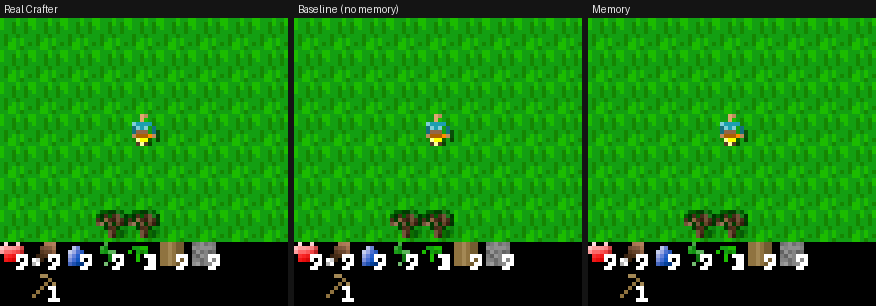
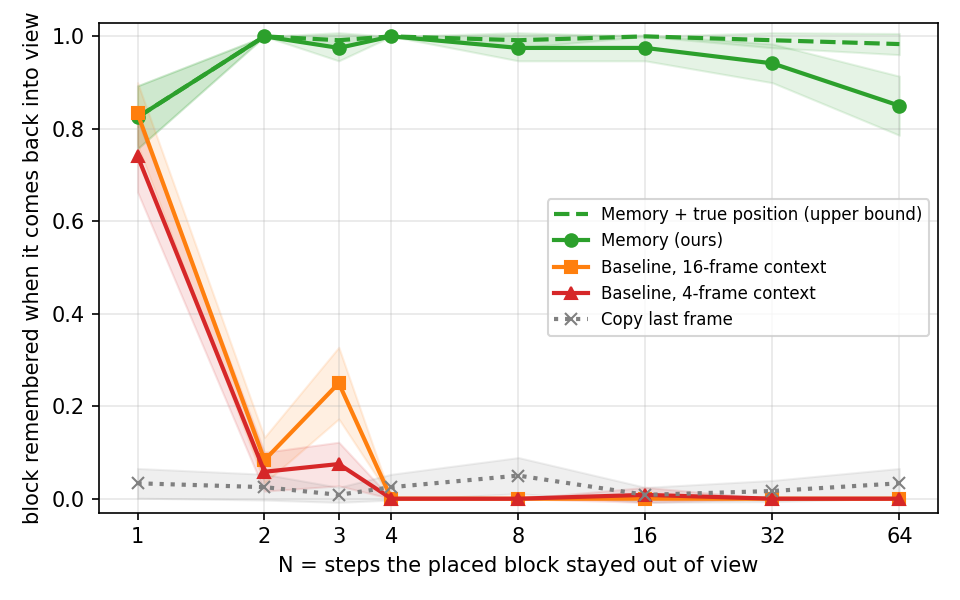

# Persistent Crafter World Model

키보드로 플레이할 수 있는 신경망 Crafter(action-conditioned world model)를 만들고, **플레이어가 바꾼 세계를 시야 밖에 나갔다 돌아왔을 때도 기억하는지** 측정한 프로젝트.
짧은 context만 보는 모델은 설치한 블록이 시야에서 4스텝만 벗어나도 **0%** 기억하지만, 위치 기반 memory를 붙이면 64스텝 뒤에도 **85%**(위치를 정확히 알면 98%)를 기억함



돌을 놓고(1) 왼쪽으로 8칸 갔다가 같은 길로 돌아오는 같은 키 입력. 시작 16프레임만 실제 Crafter이고, 이후는 각 모델의 출력만으로 진행. Baseline은 돌과 나무를 잊고, Memory는 기억함

## Architecture

```
과거 4프레임 ─────────────────────────────┐
행동 → Embedding → AdaGN (모든 블록) ───────┼→ UNet (72→36→18→9, 9×9 self-attention) → 다음 프레임
Memory: 다음 시야와 가장 많이 겹치는 과거 프레임 │
        → 위치 차이만큼 8px 단위로 정렬 → [RGB, 유효 마스크, 나이] ┘
위치 추정: 모델이 그린 다음 프레임이 8px 밀렸는지로 이동 성공을 판정해 누적
```

- **환경**: Crafter 72×72 렌더링(타일 1칸 = 8px), 낮밤 고정(밤의 랜덤 노이즈가 지표를 오염시킴)
- **데이터**: 랜덤 + 스크립트 정책(설치·채집 → 멀리 이동 → 같은 길로 복귀) 30만 프레임
- **World Model**: 결정론적 UNet(16.9M), 과거 4프레임 + 행동으로 다음 프레임 예측. 손실 = MSE + L1
- **Memory**: 매 스텝 (위치, 프레임)을 저장하고, 다음에 새로 드러나는 줄을 담은 가장 최근 과거 프레임을 검색해 현재 시야에 정렬해서 입력. 위치는 정답이 아니라 모델이 그린 화면에서 추정하므로 baseline과 같은 정보(프레임 + 행동)만 사용
- **설치·채집 학습**: 바뀌는 칸이 화면의 1.2%라 처음엔 변화를 전혀 그리지 못함(0%) → 상호작용 성공·실패 장면을 배치에 섞고, 바뀐 칸과 실패 장면의 대상 칸에 손실 가중치(×11)
- **평가**: 실제 Crafter에서 검증한 재방문 시나리오 1,920개(설치·채집·대조군 × N 8가지). 타일 판정은 텍스처 템플릿 매칭(실제 프레임에서 100% 일치)

## Results



| 다시 보인 순간 블록을 기억한 비율, N | 1 | 2 | 3 | 4 | 8 | 16 | 32 | 64 |
|---|---|---|---|---|---|---|---|---|
| Baseline, 4-frame context | 0.74 | 0.06 | 0.07 | 0.00 | 0.00 | 0.01 | 0.00 | 0.00 |
| Baseline, 16-frame context | 0.83 | 0.08 | 0.25 | 0.00 | 0.00 | 0.00 | 0.00 | 0.00 |
| **Memory** | 0.82 | **1.00** | **0.97** | **1.00** | **0.97** | **0.97** | **0.94** | **0.85** |
| Memory + 실제 위치 (상한) | 0.82 | 1.00 | 0.99 | 1.00 | 0.99 | 1.00 | 0.99 | 0.98 |

- **망각은 context 길이에서 즉시 일어남**: baseline은 바꾼 블록이 context 밖으로 밀려나면(N≥4) 원래 재질(풀)로 다시 그림
- **context를 늘려도 해결되지 않음**: 16프레임 context는 블록이 context 안에 있어도(N=4~15) 0%. 플레이어가 움직여 옛 프레임 속 위치가 어긋난 정보를 스스로 가져오지 못함
- **정렬된 memory가 해결**: 정렬 없이 원본 프레임 + 위치 차이만 주면 N=64에서 0.65~0.75로 떨어지고, 검색 규칙이 바뀌면 크게 흔들림
- **긴 N의 남은 실패는 위치 오류**: 위치가 맞으면 0.99 이상, 틀리면 0. 위치 오류의 대부분은 모델이 길 위에 없던 물·돌·나무를 지어내 그 세계 안에서 "막힘"으로 그린 경우
- **설치도 모델이 직접 그림**: 변화 직전부터 rollout해도 같은 곡선(N=64에서 0.84). 실패한 설치(재료 부족 등)를 그리는 비율 0~1%

## 한계

- 결정론적 모델이라 처음 보는 영역은 단순한 풀밭으로 그리는 경향(나무·물이 사라짐). 이 상상 오류가 긴 N의 위치 오류로 이어짐
- 짧은 N(1~3)에서 baseline이 context 속 블록을 다시 가져오는 능력은 학습 run마다 크게 다름 (seed 간 최대 0.16 차이)
- 평가 단순화를 위해 낮으로 고정해 원본 Crafter보다 좀비가 적음

## 실행 방법

```bash
conda env create -f environment.yml && conda activate pcwm

python src/collect.py                                   # 학습 데이터 30만 프레임
python src/scenarios.py                                 # 재방문 평가 시나리오
python src/interact_index.py && python src/memory_index.py --rule recent

python src/train.py --config configs/memory_aligned_v3.yaml   # memory 모델 (RTX 5060 Ti 약 3.5시간)
python src/train.py --config configs/baseline_v2.yaml         # baseline
python src/eval_revisit.py --model outputs/memory_aligned_v3/last.pt

python src/web_demo.py                                  # 브라우저 데모 http://localhost:8765
```
